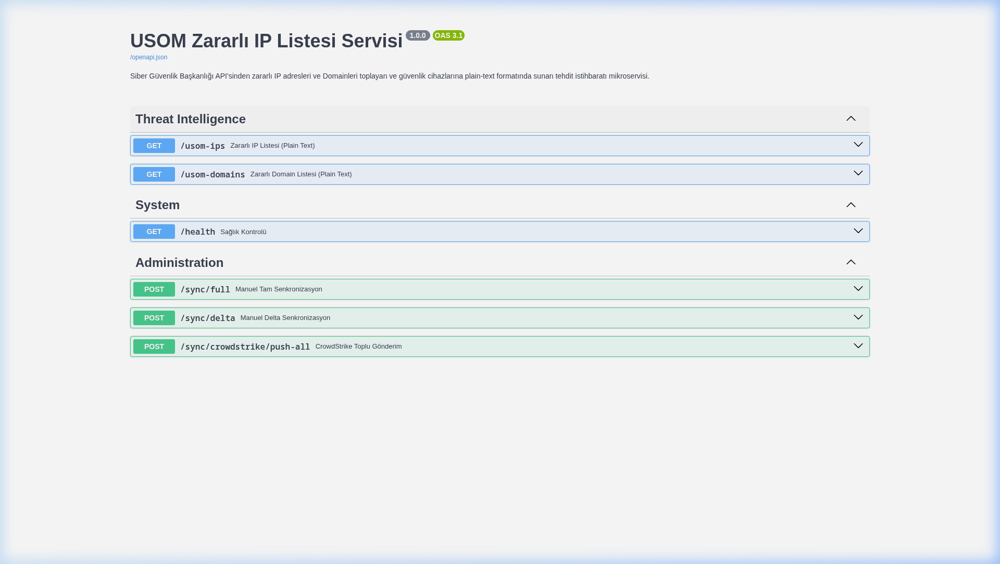
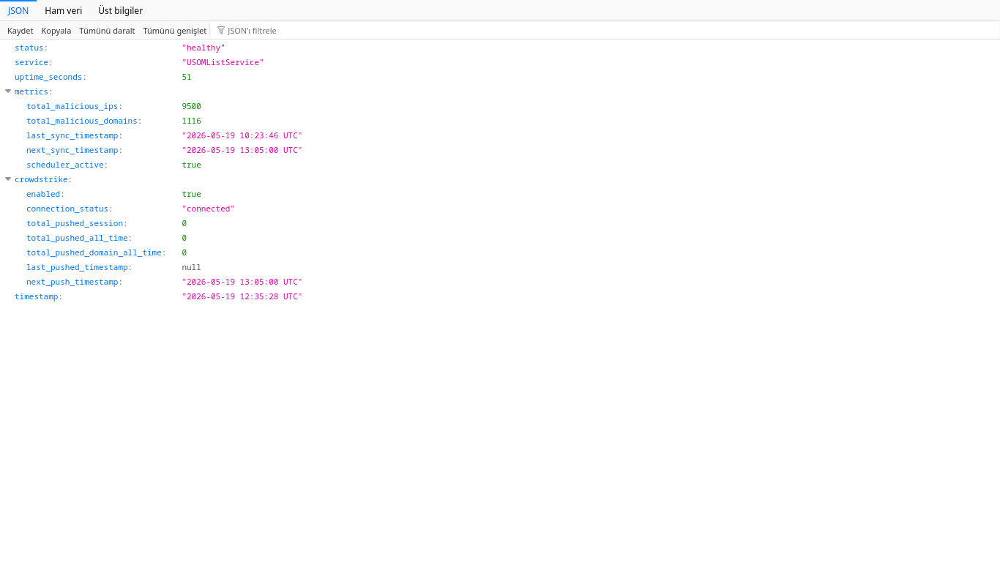

# 🛡️ SGB - USOM Zararlı IP, Domain ve Hash Listesi Güvenlik Cihazları Entegrasyon Servisi

Siber Güvenlik Başkanlığı (SGB) / USOM tarafından yapılan bilgilendirmeye göre, `url-list.txt` formatında paylaşılan zararlı bağlantılar listesi hizmeti 1 Haziran 2026 tarihi itibarıyla sona erecek; zararlı bağlantı verileri bundan sonra yalnızca API altyapısı üzerinden paylaşılacaktır.
**USOM List Service**, doğrudan karmaşık API entegrasyonu (özellikle sayfalama, rate-limit vb. özellikleri) desteklemeyen, **External Dynamic List (EDL)** olarak sadece düz metin (plain text) formatındaki IP ve Domain listelerini tüketebilen Güvenlik Duvarı (Palo Alto, Fortinet vb.), WAF ve Mail Gateway'ler için geliştirilmiş **ara katman olarak kullanılabilecek, self-hosted kullanılabilecek açık kaynaklı bir projedir.**

## ✨ Öne Çıkan Özellikler

- **Kesintisiz Cihaz Entegrasyonu:** Güvenlik cihazlarınız, konfigürasyon değişikliğine gerek duymadan `http://sunucu_ip:8000/usom-ips` üzerinden geleneksel formattaki (CR-LF satır sonu) listeyi çekebilir.
- **Akıllı Senkronizasyon (Delta & Full):** APScheduler kullanılarak oluşturulan arka plan görevleri ile veri çekim işlemleri tam otomatik hale getirilmiştir.
  - *IP Saatlik Delta Sync:* Yalnızca yeni eklenen IP adreslerini çekerek API limitlerini yormaz. (Her saatin 5. dakikasında çalışır).
  - *Domain Saatlik Delta Sync:* Yalnızca yeni eklenen Domain adreslerini çeker. (Her saatin 10. dakikasında çalışır).
  - *Hash Saatlik Sync:* abuse.ch MalwareBazaar'dan güncel zararlı yazılım hash'lerini çeker. (Her saatin 15. dakikasında çalışır).
  - *IP Haftalık Full Sync:* Veritabanı tutarlılığını sağlamak için baştan sona tüm IP listesini kontrol eder. (Her Pazar gecesi 03:00'te çalışır).
  - *Domain Haftalık Full Sync:* Baştan sona tüm Domain listesini senkronize eder. (Her Pazar gecesi 04:00'te çalışır).
  - *Veri Çekim Düzeni (Rate Limit Koruması):* USOM API'sinin kısıtlamalarına takılmamak adına eşzamanlı HTTP istek sayısı (Semaphore) limitlenmiş ve başarısız isteklere karşı üstel bekleme (exponential backoff retry) mekanizması eklenmiştir. Delta (saatlik) senkronizasyonlarda, sayfalar taranırken daha önceden veritabanında olan bir kayda rastlandığında gereksiz API çağrısı yapmamak için işlem erken sonlandırılır (early stop).
- **Zararlı Yazılım Hash Beslemesi:** USOM hash yayınlamadığı için hash istihbaratı [abuse.ch MalwareBazaar](https://bazaar.abuse.ch/)'dan alınır. API anahtarı gerektirmez. Çekilen SHA256 hash'leri CrowdStrike'a `prevent` aksiyonuyla basılabilir (bu tipte engelleme desteklenir) ve `/malware-hashes` üzerinden düz metin olarak sunulur.
- **CrowdStrike Falcon Entegrasyonu (Opsiyonel):** USOM'dan çekilen zararlı IP ve Domain'leri ve MalwareBazaar'dan çekilen hash'leri asenkron olarak CrowdStrike IOC veritabanına otomatik basar. (Whitelist özelliği ile false-positive'leri engeller).
- **Dayanıklı Gönderim:** CrowdStrike'ta zaten kayıtlı olan göstergeler ("duplicate") başarı sayılıp işaretlenir, böylece kuyrukta sonsuza kadar takılı kalmazlar. Batch tamamen reddedilirse ikiye bölünüp yeniden denenir; tüm API çağrıları zaman aşımına bağlıdır ve uzun gönderimler her 2.000 kayıtta veritabanına işaretlenir (checkpoint), böylece süreç kesilse bile ilerleme kaybolmaz.
- **İzlenebilirlik:** `logs/service.log` dosyasına dönen (rotating) log yazılır; journald erişimi olmayan ortamlarda da arıza incelenebilir. `/health` uç noktası son **başarılı senkronizasyonun** üzerinden 2 saatten fazla geçmişse `degraded` döner ve zamanlanmış bir görev atlanır/hata verirse log'a `ZAMANLAYICI ALARM` satırı düşer.
- **Yüksek Performans:** Python FastAPI, `aiosqlite` (Async SQLite) ve `httpx` kullanılarak asenkron mimaride geliştirilmiştir.

## 🛠️ Kurulum

Projeyi Linux sunucunuzda sanal ortam (virtual environment - venv) kullanarak ayağa kaldırmak için aşağıdaki adımları takip edebilirsiniz.

### 1. Depoyu Klonlayın ve Klasöre Geçin

```bash
git clone https://github.com/emreefedogan/SGB-USOMFeedService.git
cd SGB-USOMFeedService
```

### 2. Python ve Sanal Ortam (venv) Kurulumu

Gerekli Python paketlerinin sistem genelini etkilememesi için bir sanal ortam oluşturun. Kullanmakta olduğunuz Linux dağıtımına göre gerekli paketleri yükleyin:

**Debian / Ubuntu:**
```bash
sudo apt update && sudo apt install -y python3 python3-venv python3-pip
```

**Arch Linux:**
```bash
sudo pacman -Syu python python-pip
```

**RedHat / CentOS / Fedora:**
```bash
sudo dnf install -y python3 python3-pip
```

Ardından sanal ortamı oluşturup aktif edin:

```bash
# Sanal ortamı oluşturun
python3 -m venv venv

# Sanal ortamı aktif edin
source venv/bin/activate
```

### 3. Bağımlılıkları Yükleyin

```bash
pip install --upgrade pip
pip install -r requirements.txt
```

### 4. Yapılandırma Dosyasını Hazırlayın

Ortam değişkenleri dosyasını kopyalayın ve düzenleyin (CrowdStrike entegrasyonu kullanacaksanız Falcon API bilgilerini girin, istemiyorsanız boş bırakabilirsiniz):

```bash
cp .env.example .env
nano .env
```

### 5. Uygulamayı Başlatın

Uygulamayı uvicorn ile başlatarak test edebilirsiniz:

```bash
uvicorn main:app --host 0.0.0.0 --port 8000
```
Servis `http://<sunucu_ip>:8000` portundan yayına başlayacaktır.

---

## 🖥️ Systemd Servisi Olarak Arka Planda Çalıştırma

Uygulamanın sunucu yeniden başladığında otomatik açılması ve arka planda sürekli çalışması için bir Systemd servis dosyası oluşturabilirsiniz.

1. `/etc/systemd/system/usom-feed.service` dosyasını oluşturun:

```bash
sudo nano /etc/systemd/system/usom-feed.service
```

2. Aşağıdaki şablonu kendi kullanıcı adınız ve dizin yolunuza göre düzenleyip yapıştırın:

```ini
[Unit]
Description=USOM Malicious Threat Intelligence Feed Service
After=network.target

[Service]
User=KULLANICI_ADINIZ
Group=KULLANICI_ADINIZ
WorkingDirectory=/home/KULLANICI_ADINIZ/SGB-USOMFeedService
Environment="PATH=/home/KULLANICI_ADINIZ/SGB-USOMFeedService/venv/bin"
ExecStart=/home/KULLANICI_ADINIZ/SGB-USOMFeedService/venv/bin/uvicorn main:app --host 0.0.0.0 --port 8000
Restart=always
RestartSec=5
StandardOutput=journal
StandardError=journal
SyslogIdentifier=usom-feed-service

[Install]
WantedBy=multi-user.target
```

3. Servisi etkinleştirin ve başlatın:

```bash
# systemd yapılandırmasını yeniden yükleyin
sudo systemctl daemon-reload

# Servisi başlangıçta otomatik çalışacak şekilde ayarlayın
sudo systemctl enable usom-feed.service

# Servisi başlatın
sudo systemctl start usom-feed.service

# Durumunu kontrol edin
sudo systemctl status usom-feed.service
```

## ⚙️ Konfigürasyon (`.env`)

Eğer CrowdStrike entegrasyonunu kullanmak **istemiyorsanız**, `.env` dosyasını boş bırakabilir veya içerisindeki `FALCON_CLIENT_ID` satırlarını silebilirsiniz. Sistem CrowdStrike olmadan sadece web sunucusu olarak çalışmaya devam edecektir — USOM ve MalwareBazaar senkronizasyonları ile tüm besleme uç noktaları normal şekilde çalışır.

```ini
# .env dosyası

# Panoda (/) ve API dokümantasyonunda (/docs) görünen servis adı.
# Kurumunuzun adını yansıtmak için bu satırı değiştirmeniz yeterlidir.
SERVICE_TITLE="USOM Tehdit İstihbaratı Servisi"

FALCON_CLIENT_ID="YOUR_CLIENT_ID_HERE"
FALCON_CLIENT_SECRET="YOUR_CLIENT_SECRET_HERE"
FALCON_BASE_URL="https://api.crowdstrike.com"  # AB bulutu için: https://api.eu-1.crowdstrike.com

# Domain ve IP göstergeleri için aksiyon.
# Geçerli değerler: detect | no_action | allow
FALCON_IOC_ACTION="detect"

# Zararlı yazılım hash'leri (SHA256) için aksiyon.
# Geçerli değerler: prevent | prevent_no_ui | detect | no_action | allow
FALCON_HASH_ACTION="prevent"

# Gönderimi, entegrasyonu kapatmadan durdurur (varsayılan: true).
# false iken göstergeler toplanır ve beslemelerden sunulur, ancak
# CrowdStrike'a yeni gösterge basılmaz. Silme işlemleri çalışmaya devam eder.
FALCON_PUSH_ENABLED="true"
```

> 💡 **`FALCON_PUSH_ENABLED` ne zaman gerekir?** CrowdStrike tenant'ının 1 milyonluk gösterge limiti dolduğunda gönderim her turda `400 — Limit of 1 million indicators reached` ile reddedilir; kod batch'i tek tek göstergeye kadar bölerek yeniden dener ve API'ye on binlerce baştan mahkûm istek gider. Bu bayrak o döngüyü, silme yeteneğini kaybetmeden durdurur — böylece önce `/indicators` ile yer açıp sonra gönderimi tekrar açabilirsiniz.

> ⚠️ **Aksiyon tiplere göre kısıtlıdır.** CrowdStrike `prevent` / `prevent_no_ui` aksiyonunu **yalnızca hash (SHA256/MD5) tiplerinde** kabul eder; `domain` ve `ipv4` için bu değerler `HTTP 400` ile reddedilir ve o tiplerde tavan `detect`'tir. IP/Domain engellemesi Falcon'da IOC yönetimiyle değil, Firewall Management politikalarıyla yapılır. Yanlış bir değer girilirse servis çalışmayı sürdürür ve güvenli varsayılana (`detect`) düşerek log'a uyarı yazar.

## 📡 API Uç Noktaları (Endpoints)

Servis ayağa kalktığında aşağıdaki uç noktalara hizmet verir:

| Endpoint | Metot | Açıklama |
|---|---|---|
| `/` | GET | **Durum panosu.** Besleme sayıları, CrowdStrike gönderim ilerlemesi, kaynak dağılımı ve canlı olay akışını gösteren tek sayfalık web arayüzü. |
| `/usom-ips` | GET | Zararlı IP adreslerini düz metin (plain-text, satır başı bir IP) formatında döner. Firewall'lar (EDL) için kullanılır. |
| `/usom-domains` | GET | Zararlı Domain adreslerini düz metin formatında döner. |
| `/malware-hashes` | GET | Zararlı yazılım **SHA256** hash'lerini düz metin formatında döner (kaynak: MalwareBazaar). |
| `/malware-hashes/md5` | GET | Aynı örneklerin **MD5** karşılıkları. Yalnızca MD5 kabul eden eski sistemler içindir. |
| `/health` | GET | Servis sağlığı, uptime, veritabanındaki toplam kayıt sayısı, CrowdStrike bağlantı durumu ve son sync zamanları gibi detaylı metrikleri (JSON) döner. |
| `/stats` | GET | Kaynak bazlı sayımlar, gönderim oranları ve CrowdStrike kuyruk durumu (JSON). |
| `/stats/distribution` | GET | Göstergelerin kaynağa ve tipe göre dağılımı — panodaki grafikleri besler. |
| `/lookup?q=<değer>` | GET | Tek bir gösterge sorgulaması: değer veritabanında var mı, hangi kaynaktan geldi, CrowdStrike'a basıldı mı. IP, domain ve hash tablolarının üçünde birden arar. |
| `/recent` | GET | Veritabanına en son eklenen göstergeleri tarihe göre azalan döndürür. |
| `/export/{kind}.csv` | GET | Göstergeleri CSV olarak dışa aktarır (`kind`: `ip`, `domain`, `hash`). Sütunlar: `value, added_at, pushed_to_cs`. |
| `/events` | GET | **SSE** canlı durum akışı — pano, senkronizasyon olaylarını yeniden sorgulamadan bu akıştan alır. |
| `/sync/delta` | POST | Manuel olarak saatlik "Delta Sync" (sadece yeniler) görevini tetikler. |
| `/sync/full` | POST | Manuel olarak tam senkronizasyon görevini tetikler. |
| `/sync/hashes` | POST | Manuel olarak hash senkronizasyonunu (MalwareBazaar → DB → CrowdStrike) tetikler. |
| `/sync/brandefense` | POST | Manuel olarak Brandefense senkronizasyonunu tetikler (API anahtarı tanımlıysa). |
| `/sync/crowdstrike/push-all` | POST | Gönderilmemiş IP, Domain ve Hash'leri manuel olarak CrowdStrike'a basar. |
| `/sync/retry-blocked` | POST | CrowdStrike tarafından reddedilmiş göstergeleri yeniden göndermeyi dener. |
| `/indicators` | DELETE | Tek bir göstergeyi CrowdStrike'tan ve veritabanından siler, kalıcı dışlama listesine alır. |
| `/retention/preview` | GET | Saklama politikası şu an uygulansa neyin silineceğini sayar — hiçbir yan etkisi yok. |
| `/retention/run` | POST | Saklama temizliğini tetikler. Silmek için açıkça `dry_run=false` gerekir. |
| `/indicators/deleted` | GET | Silinmiş (kalıcı olarak dışlanmış) göstergeleri listeler. |
| `/indicators/restore` | POST | Dışlamayı kaldırır; gösterge bir sonraki senkronizasyonda geri gelebilir. |

Düz metin uç noktaları satır başına tek kayıt (CR-LF) döner, `X-Total-Count` başlığında toplam sayıyı bildirir ve 5 dakikalık `Cache-Control` uygular.

### 🗑️ Gösterge Silme (Yanlış Pozitif Temizliği)

Panodaki **Gösterge sorgulama** kutusunda bir değer arandığında, sonuç satırının sağında **Sil** butonu çıkar. Buton üç işi tek adımda yapar:

1. Göstergeyi **CrowdStrike IOC veritabanından** siler (FQL ile id bulunur, ardından silinir).
2. Yerel veritabanından siler — gösterge aynı anda `/usom-ips`, `/usom-domains` ve `/malware-hashes` beslemelerinden düşer.
3. **Kalıcı dışlama listesine** (`deleted_iocs`) yazar.

Üçüncü adım özellikle önemlidir: USOM silinen göstergeyi yayınlamaya devam ettiği için, yalnızca satırı silmek yetmez — bir sonraki saatlik delta sync aynı değeri geri ekler ve CrowdStrike'a yeniden basar. Dışlama listesi `insert_*` yollarında filtrelendiği için silme kalıcıdır.

Hash tarafında SHA256 ve MD5 birlikte dışlanır: operatör MD5 ile silse bile aynı örnek SHA256 üzerinden geri gelmez.

Yanlışlıkla silinen bir gösterge **Geri al** ile kurtarılabilir. Geri alma yalnızca dışlamayı kaldırır; satırı kendisi yazmaz — kaynak göstergeyi hâlâ yayınlıyorsa bir sonraki senkronizasyon normal yoluyla geri getirir.

```bash
# Tek bir IP'yi sil
curl -X DELETE "http://localhost:8000/indicators?value=203.0.113.10&type=ip"

# Silinmişleri listele
curl "http://localhost:8000/indicators/deleted"

# Geri al
curl -X POST "http://localhost:8000/indicators/restore?value=203.0.113.10&type=ip"
```

### ♻️ Saklama Politikası (Gösterge Limiti Yönetimi)

CrowdStrike tenant başına **1 milyon** gösterge kabul eder. Sınır dolduğunda yeni gösterge yazılamaz ve her gönderim şu hatayla reddedilir:

```
Limit of 1 million indicators reached. To add these indicators,
remove existing indicators to remain under the limit.
```

Bu, sessiz ama ciddi bir arızadır: servis çalışmaya devam eder, beslemeler güncellenir, ancak **en güncel tehditler EDR'a hiç ulaşmaz**. Yani eski göstergeleri süresiz tutmanın bedeli, yenilerinin engellenmemesidir.

Saklama temizliği her gün **02:30**'da çalışır, süresi dolmuş göstergeleri CrowdStrike'tan ve veritabanından kaldırarak sürekli yer açar.

**"Eski" ölçütü son görülme tarihidir, ilk ekleme değil.** Kaynak göstergeyi raporlamaya devam ettiği sürece süre yeniden başlar (`last_seen_at` her sync'te tazelenir), böylece hâlâ aktif bir tehdit asla silinmez.

**TTL kaynağa göre belirlenir**, çünkü beslemelerin anlamı farklıdır:

| Kaynak | Varsayılan | Neden |
|---|---|---|
| Brandefense | 30 gün | Saatlik 24 saatlik kayan pencere — "son gözlemler" beslemesi. Bir kez görülüp bir daha raporlanmayan IOC bayatlar. En hızlı büyüyen kaynak (~10K/gün). |
| MalwareBazaar | 30 gün | "recent" dökümü de kayan pencere; aynı mantık. |
| USOM | **0 (süresiz)** | Kayan pencere **değil**, güncel durum listesi: API'nin `totalCount`'u o an yayınlanan tüm göstergeleri kapsar. Aylar önce eklenmiş bir domain bugün hâlâ listede olabilir. Yaşa göre silmek, hâlâ yayınlanan bir tehdidin korumasını kaldırmak olurdu. |

```bash
# Ne silinecekti? (hiçbir yan etkisi yok)
curl "http://localhost:8000/retention/preview"

# Temizliği çalıştır — dry_run varsayılanı true, silmek için açıkça false
curl -X POST "http://localhost:8000/retention/run?dry_run=false"

# İlk yığını daha hızlı eritmek için üst sınırı geçici olarak yükselt
curl -X POST "http://localhost:8000/retention/run?dry_run=false&limit=100000"
```

**Emniyet kuralları:**

- **CrowdStrike kapalıysa temizlik yapılmaz.** Yerel satırı silip CrowdStrike'a dokunamamak, göstergeyi orada öksüz bırakır: değeri artık veritabanında olmadığı için bir daha bulunup silinemez ve kotayı sonsuza kadar işgal eder.
- **CrowdStrike silme hatası verirse yerel satır korunur** — aynı sebeple.
- `RETENTION_MAX_PER_RUN` (varsayılan 50.000) tur başına üst sınırdır; yanlış bir TTL'in tenant'ı tek gecede boşaltmasını engeller. Sınıra takılan turlar log'a uyarı yazar.
- Süresi dolup silinen bir gösterge, kaynak onu yeniden raporlarsa **geri gelir**. Panodaki *Sil* butonuyla yapılan operatör silmesinden farkı budur: o kalıcı dışlamadır, bu değildir.

Bundan sonra basılan göstergeler CrowdStrike'a kendi `expiration` tarihleri ve besleme etiketleriyle (`feed-brandefense` vb.) yazılır; CrowdStrike süresi dolanları kendiliğinden işaretler ve temizlik tek bir ucuz sorguyla çalışabilir.

> ⚠️ **Silme yıkıcı bir işlemdir ve servis kimlik doğrulama uygulamaz.** Porta erişebilen herkes gösterge silebilir, yani bir göstergenin kurum genelinde engellenmesini kaldırabilir. Servisi herkese açık bir arayüze bağlıyorsanız önüne ters vekil (reverse proxy) koyup kimlik doğrulama ekleyin veya `/indicators*` uçlarını ağ seviyesinde kısıtlayın.

### `/health` çıktısındaki iki farklı zaman damgası

| Alan | Anlamı |
|---|---|
| `last_sync_timestamp` | Veritabanına **en son yeni kaydın** eklendiği an — veri tazeliği. |
| `last_successful_sync` | Bir senkronizasyonun **en son başarıyla tamamlandığı** an — servis sağlığı. `sync_age_seconds` ve `degraded` kararı bu alandan hesaplanır. |

Bu ayrım önemlidir: USOM saatlerce yeni gösterge yayınlamayabilir; bu, servisin arızalı olduğu anlamına gelmez.

---

## 📸 Ekran Görüntüleri

#### 1. İnteraktif API Dokümantasyonu (Swagger UI - `/docs`)


#### 2. Servis Sağlık ve Senkronizasyon Durumu (JSON - `/health`)


---

## 🤝 Güvenlik Ürünleri Entegrasyon Kılavuzu

Servisin sunduğu beslemeleri (feeds) kurumsal güvenlik ürünlerinize entegre etmek için aşağıdaki adımları izleyebilirsiniz.

### 1. Güvenlik Duvarı ve Ağ Güvenlik Cihazları (EDL / Threat Feed)

Bu entegrasyon yöntemi, `/usom-ips` ve `/usom-domains` uç noktalarından dönen düz metin listelerini otomatik olarak çekerek engelleme kurallarında kullanır.

#### 🧱 Palo Alto Networks (External Dynamic List - EDL)
1. **Objects > External Dynamic Lists** menüsüne gidin ve **Add** butonuna tıklayın.
2. **Name** alanına anlamlı bir isim verin (Örn: `USOM-Zarafli-IPler`).
3. **Type** olarak `IP List` veya `Domain List` seçin.
4. **Source** alanına ilgili endpoint adresini girin:
   - IP'ler için: `http://<sunucu_ip>:8000/usom-ips`
   - Domainler için: `http://<sunucu_ip>:8000/usom-domains`
5. **Check for updates** (Güncelleme Sıklığı) değerini **Hourly** (Saatlik) olarak ayarlayın.
6. Bu EDL nesnesini Security Policies (Güvenlik Kuralları) altında kaynak (source) veya hedef (destination) engelleme kurallarınıza dahil edin.

#### 🛡️ Fortinet FortiGate (Threat Feed / External Connector)
1. **Security Fabric > External Connectors** menüsüne gidin.
2. **Create New** diyerek **Threat Feeds** altından `IP Address` veya `Domain Name` seçeneğini seçin.
3. **Name** alanını doldurun (Örn: `USOM_Domain_Feed`).
4. **URL of external server** alanına endpoint adresini girin:
   - `http://<sunucu_ip>:8000/usom-domains` (veya `/usom-ips`)
5. **Refresh Interval** değerini **Hourly** olarak ayarlayın.
6. Oluşturulan bu konnektörü Firewall Policy altında engelleme nesnesi olarak kullanın.

#### 🧬 Hash Beslemesi (EDR / Sandbox / Antivirüs)
`/malware-hashes` uç noktası satır başına bir SHA256 döndürür ve hash listesi (hash set) tüketebilen ürünlerde kullanılabilir:
- **Kaynak:** `http://<sunucu_ip>:8000/malware-hashes`
- **Güncelleme sıklığı:** Saatlik önerilir (servis kendi verisini her saat `:15`'te tazeler).
- Yalnızca MD5 kabul eden eski sistemler için: `http://<sunucu_ip>:8000/malware-hashes/md5`

> MalwareBazaar'ın "recent" dökümü son ~48 saati kapsar; servis bu dökümü saatlik çekip **kalıcı olarak kendi veritabanında biriktirir**. Bu nedenle uç noktadan dönen liste 48 saatle sınırlı değildir, servisin çalıştığı süre boyunca büyür.

---

### 2. CrowdStrike Falcon EDR/XDR Entegrasyonu (IOC Push)

Servis, USOM'dan çekilen zararlı göstergeleri (indicators) asenkron olarak doğrudan CrowdStrike Falcon platformuna basar.

#### 🔑 Gerekli API İzinleri (Scope)
CrowdStrike Falcon Console üzerinde **Support and Resources > API Clients and Keys** alanından yeni bir API Client oluşturun. Atamanız gereken minimum yetki (scope) düzeyi şu şekildedir:
* **Indicators (IOCs):** `Write` ve `Read`

#### ⚙️ Yapılandırma (`.env`)
Oluşturduğunuz API kimlik bilgilerini projenin `.env` dosyasına girin:
```ini
# CrowdStrike Falcon API Ayarları
FALCON_CLIENT_ID="KAYITLI_CLIENT_ID"
FALCON_CLIENT_SECRET="KAYITLI_CLIENT_SECRET"
FALCON_BASE_URL="https://api.crowdstrike.com"
FALCON_IOC_ACTION="detect"    # domain + ipv4 (prevent bu tiplerde desteklenmez)
FALCON_HASH_ACTION="prevent"  # sha256
```

#### 🎯 Gösterge Tipi ↔ Aksiyon Uyumu

| IOC Tipi | Kaynak | Desteklenen aksiyonlar |
|---|---|---|
| `ipv4` | USOM | `detect`, `no_action`, `allow` |
| `domain` | USOM | `detect`, `no_action`, `allow` |
| `sha256` | MalwareBazaar | `prevent`, `prevent_no_ui`, `detect`, `no_action`, `allow` |

`url` CrowdStrike'ta geçerli bir IOC tipi **değildir**; USOM'un URL verisi bu nedenle IOC olarak basılamaz.

#### ⚙️ Çalışma Mantığı ve False-Positive Önleme
- **Asenkron Gönderim:** Senkronizasyon tamamlandığında, veritabanına yeni eklenen ve CrowdStrike'a henüz basılmamış olan tüm göstergeler toplu olarak (batch) CrowdStrike Indicators API'sine gönderilir.
- **Whitelist Koruması:** `main.py` içinde yer alan `WHITELISTED_DOMAINS` listesi sayesinde (Microsoft, Google, Github vb. kritik servisler) CrowdStrike'a IOC olarak gönderilmez. Bu sayede kurumsal altyapınızda yaşanabilecek false-positive kesintilerin önüne geçilir.
- **Duplicate Toleransı:** CrowdStrike, bir batch içinde tek bir gösterge bile "zaten kayıtlı" uyarısı üretirse isteğin tamamını `400` ile reddeder. Servis bu yanıtı satır satır ayrıştırır; zaten kayıtlı olanları başarı sayıp veritabanında işaretler, gerçekten geçersiz olanları loglayıp atlar ve kalanı yeniden gönderir.

> ⚠️ **`prevent` kullanmadan önce.** Hash beslemesi üçüncü taraf bir kaynaktır (abuse.ch). `prevent` aksiyonu dosyanın çalıştırılmasını gerçekten engeller; yanlış pozitif bir kayıt kurum genelinde meşru bir dosyayı bloke edebilir. İlk kurulumda `FALCON_HASH_ACTION="detect"` ile başlayıp Falcon konsolunda tetiklenmeleri birkaç hafta izlemeniz, ardından `prevent`e geçmeniz önerilir.

## 📝 Lisans

Bu proje MIT Lisansı ile lisanslanmıştır. Detaylar için `LICENSE` dosyasına bakabilirsiniz.
